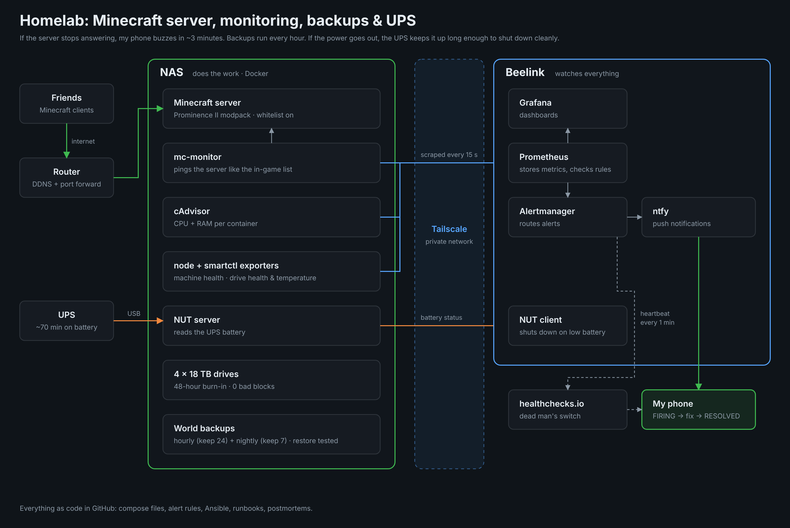

# homelab

A two-machine homelab run like a small production environment: everything is defined in Git, every alert has a runbook, and every outage real or drilled gets a blameless postmortem.

## What runs where

| Machine | Role | Runs |
|---|---|---|
| **NAS** — Jonsbo N5, i5-14600K, 64 GB RAM, ZFS RAIDZ1 on 4× 18 TB (47 TiB usable), 2.5 GbE, Ubuntu 26.04 | Does the work | **Media:** Jellyfin, Seerr, Sonarr, Radarr, Prowlarr, SABnzbd, qBittorrent (VPN-only via gluetun), Bazarr, Clonarr, Jellystat, Caddy ([docs/media.md](docs/media.md)) · **Music:** Navidrome · **Apps:** Vaultwarden, Immich, BookStack, Homepage dashboard (LAN/Tailscale only) · **Games:** modded Minecraft + mc-monitor · **Infra:** Samba, Cloudflare DDNS, cAdvisor, node_exporter, smartctl-exporter, NUT server (UPS over USB) |
| **Beelink SER Pro** — Ubuntu 26.04 | Watches everything | Prometheus, Grafana, Alertmanager, blackbox exporter, ntfy (push to phone), node_exporter, NUT client |
| **healthchecks.io** | Watches the watcher | Dead man's switch for the alerting chain, backup checks, DDNS heartbeat |
| **UptimeRobot** | Watches from outside | Checks the public sites every 5 min from the internet, the path family actually uses (DNS → ISP → router → Caddy) |
| **Backblaze B2** | Off-site copy | Encrypted restic backups, bucket and key managed with Terraform |

The two machines talk over **Tailscale**. Internal services are bound to the LAN and Tailscale addresses only (Docker-published ports bypass UFW, so nothing internal listens on `0.0.0.0`).

**Exposed to the internet and nothing else:**

| Port | Goes to | Why |
|---|---|---|
| 443 / 80 | Caddy → Jellyfin (`watch.<your-domain>`), Seerr (`request.<your-domain>`) and Navidrome (`music.<your-domain>`) | Family on smart TVs; automatic HTTPS, admin login blocked from outside, per-user lockouts, **CrowdSec** bans scanners and brute-force IPs before they reach the apps |
| 25565 | Minecraft | Whitelisted game server |

Vaultwarden is reachable only through `tailscale serve` (HTTPS, tailnet only); everything else is LAN + Tailscale.

## Storage

| Dataset / disk | Mount | Used for |
|---|---|---|
| `tank/data` (recordsize 1M) | `/data` | Media library + Usenet downloads (TRaSH Guides hardlink layout) |
| `tank/files` | `/tank/files` | Samba file share (SMB3 only, LAN + Tailscale) |
| `tank/photos` | `/tank/photos` | Immich photo library + its database dumps |
| `tank/gameservers` | `/tank/gameservers` | Game server data |
| `tank/backups` | `/tank/backups` | Backups: Minecraft worlds, BookStack, Vaultwarden |
| NVMe (1 TB) | `/opt/appdata` | Live app data and databases (fast tier) |

RAIDZ1 survives any one drive failing. lz4 compression and `atime=off` on everything, ZFS ARC capped at 16 GiB, monthly scrubs. Databases live on the NVMe; their backups go to the pool, so each copy is on different hardware. Everything irreplaceable is also backed up **off-site every night** with restic to Backblaze B2 (encrypted before it leaves the NAS; see [docs/backups.md](docs/backups.md)).

## How a problem reaches my phone

    exporters / blackbox probes → Prometheus (every 15 s) → alert rule (for: …)
                 → Alertmanager → ntfy-alertmanager → ntfy → phone (with runbook link)
    Alertmanager → Watchdog heartbeat every 1 min → healthchecks.io → Discord / email / ntfy.sh

| Alert | Fires when | Runbook |
|---|---|---|
| TargetDown | Prometheus can't scrape a target for 2 min | [target-down.md](docs/runbooks/target-down.md) |
| Watchdog (dead man's switch) | healthchecks.io stops getting heartbeats | [watchdog-down.md](docs/runbooks/watchdog-down.md) |
| ServiceDown | Any probed web app stops answering for 2 min — Jellyfin and Vaultwarden critical; Seerr, *arr apps, SABnzbd, qBittorrent, Immich, BookStack warning; Navidrome warning; public URLs `jellyfin-public` critical, `seerr-public` and `navidrome-public` warning | `docs/runbooks/<service>-down.md` (e.g. [media-down.md](docs/runbooks/media-down.md), [vaultwarden-down.md](docs/runbooks/vaultwarden-down.md), [caddy-down.md](docs/runbooks/caddy-down.md)) |
| CertExpiringSoon | A TLS certificate expires in under 14 days | [caddy-down.md](docs/runbooks/caddy-down.md) |
| MinecraftDown | The Minecraft server stops answering for 2 min | [minecraft-down.md](docs/runbooks/minecraft-down.md) |
| DriveHot | A drive is above 50 °C for 10 min | [drive-hot.md](docs/runbooks/drive-hot.md) |
| DriveFailing | A drive's SMART status reports FAILED | [drive-failing.md](docs/runbooks/drive-failing.md) |
| ZpoolNotOnline | The ZFS pool is degraded or worse for 1 min | [zpool-not-online.md](docs/runbooks/zpool-not-online.md) |
| DiskSpaceLow / PoolSpaceLow / DiskWillFillIn24h | An ext4 disk < 15% free, the pool < 7 TiB free, or anything on track to fill within 24 h | [disk-space-low.md](docs/runbooks/disk-space-low.md) |
| LowMemory | A host has < 10% RAM available for 10 min | [low-memory.md](docs/runbooks/low-memory.md) |

One generic `ServiceDown` rule covers every probed service: the `service` and `severity` come from labels on the probe, and the runbook link is built from the service name — adding a service is one line of config, not a new rule. New runbooks start from [`_TEMPLATE.md`](docs/runbooks/_TEMPLATE.md).

## Dashboards

Grafana dashboards are saved as JSON in `monitoring/grafana/dashboards/`.

| Dashboard | Answers |
|---|---|
| Node Exporter Full | Is the machine healthy? (CPU, RAM, disk, network) |
| cAdvisor | Which container is using the resources? |
| Minecraft | Is the game up, how fast does it answer, and who's playing? |
| Drives (SMART) | Drive health, temperatures, warning counters, NVMe wear |

## Rebuild from scratch

If the NAS's OS disk dies, the rebuild is: install Ubuntu → clone this repo → run one Ansible playbook → restore secrets from the password manager → `docker compose up`. The playbook sets up hardening, firewall, Docker, Tailscale, imports the ZFS pool, mounts the NVMe, and restores Samba, the UPS config and every backup schedule.

| Doc | What it covers |
|---|---|
| [docs/rebuild.md](docs/rebuild.md) | Step-by-step rebuild for three scenarios (OS disk, app-data NVMe, whole machine), secrets checklist, verification |
| [ansible/README.md](ansible/README.md) | What each role manages, dry run → apply → `changed=0`, backup schedules |
| [docs/backups.md](docs/backups.md) | What is backed up where, and how to restore from B2 |

## Repo layout

    ansible/          Host configuration (see ansible/README.md)
      roles/          base, docker, tailscale (all hosts) · nas (ZFS, NVMe mount, Samba, NUT, backup schedules)
      group_vars/     UFW rules per group
    terraform/
      b2/             Backblaze B2 bucket + bucket-scoped restic key (state kept out of Git)
    monitoring/       Beelink stack: Prometheus, Grafana, Alertmanager, blackbox, ntfy
      prometheus/rules/   Alert rules
      grafana/dashboards/ Dashboard JSON
    nas/
      media/          Jellyfin, Seerr, *arr apps, SABnzbd, qBittorrent + gluetun (VPN), Bazarr, Clonarr, Jellystat,
                      Navidrome (music), Homepage (dashboard), Caddy (custom build with CrowdSec bouncer + Caddyfile),
                      CrowdSec (acquis + whitelist)
      restic/         Nightly off-site backup script + excludes
      ddns/           Cloudflare DDNS (scoped API token, locked-down container)
      vaultwarden/    Password manager + backup script
      immich/         Photos (official compose + .env.example)
      bookstack/      Wiki + MariaDB + backup script
      gameservers/minecraft/  Minecraft server + mc-monitor + backup script
      samba/          smb.conf (deployed by Ansible)
      exporters/      node_exporter, smartctl-exporter, cAdvisor
      nut/            UPS config (deployed by Ansible; passwords in *.example only)
    docs/
      media.md        Media stack, public access, hardening, CrowdSec
      backups.md      What is backed up where, off-site restic/B2, restore steps
      rebuild.md      Rebuild the NAS from scratch (disaster recovery)
      cheatsheet.md   Everyday commands
      runbooks/       What to do when each alert fires
      postmortems/    Blameless write-ups of every outage and drill

The same repo is cloned to `/opt/stacks` on both machines; each one runs only its own folders.

## Reliability practices

- **Infrastructure as code:** Docker Compose for every service, Ansible for the hosts — including the NAS's storage, shares, UPS config and backup schedules. A second Ansible run reports `changed=0`.
- **Rebuildable:** a dead OS disk is a reinstall plus one playbook run, documented in [docs/rebuild.md](docs/rebuild.md); secrets come from the password manager, never from Git.
- **Pinned versions:** images are pinned; upgrades are a deliberate one-line change (the Minecraft modpack is the exception: it follows the latest CurseForge release via `CF_SLUG`).
- **Validate before restart:** `docker compose config -q`, `promtool check config`, `amtool check-config` and `ansible-playbook --check --diff` before any change goes live.
- **Kill-switched torrents:** qBittorrent shares the VPN container's network, so it can't reach the internet if the VPN drops (tested).
- **Least exposure:** only Caddy (443/80) and Minecraft are internet-facing; every internal port is bound to LAN/Tailscale addresses; the Jellyfin admin account can't log in from the internet.
- **Black-box monitoring:** a blackbox exporter loads each app the way a user would, so "container up, app broken" still alerts.
- **Drills:** alerts are tested by breaking things on purpose. A drill isn't finished until the *Resolved* notification arrives.
- **Planned maintenance under a silence:** Alertmanager silences scoped to the host being worked on, expired when it's back.
- **Backups with restore tests (3-2-1):** Minecraft hourly + nightly, BookStack and Vaultwarden nightly, Immich database dumps — each restore-tested into a throwaway container — then **everything irreplaceable copied off-site nightly** (restic → B2, encrypted, 7 daily / 4 weekly / 6 monthly, weekly integrity check). Schedules are managed by Ansible; missed or failed backups alert via healthchecks.io.
- **Inside and outside monitoring:** Prometheus probes from the Beelink, plus UptimeRobot checking the public URLs from the internet, so a broken router forward or ISP problem still alerts.
- **Intrusion prevention:** CrowdSec reads Caddy and Jellyfin logs and bans scanners and brute-force IPs at the proxy; home and Tailscale ranges are whitelisted.
- **Burn-in before trust:** drives got SMART short tests, a 48-hour destructive `badblocks` pass and SMART long tests; RAM got 4 passes of MemTest86 — all with zero errors before any data was stored.
- **Power protection:** a CyberPower UPS shared via NUT so both machines can shut down cleanly.
- **Secrets stay out of Git:** `.env` files, tokens and ping URLs are git-ignored; `*.example` files show the format.

## Postmortems

| Date | What happened | Write-up |
|---|---|---|
| 2026-11-17 | Minecraft drill left the server down ~9 h | [link](docs/postmortems/2026-11-17-minecraft-down-drill.md) |
| 2026-11-09 | Power loss: monitoring down ~10 h | [link](docs/postmortems/2026-11-09-power-loss-monitoring-outage.md) |
| 2026-11-08 | Alertmanager / dead man's switch drill | [link](docs/postmortems/2026-11-08-alertmanager-deadmans-drill.md) |
| 2026-11-08 | node_exporter drill | [link](docs/postmortems/2026-11-08-node-exporter-drill.md) |
